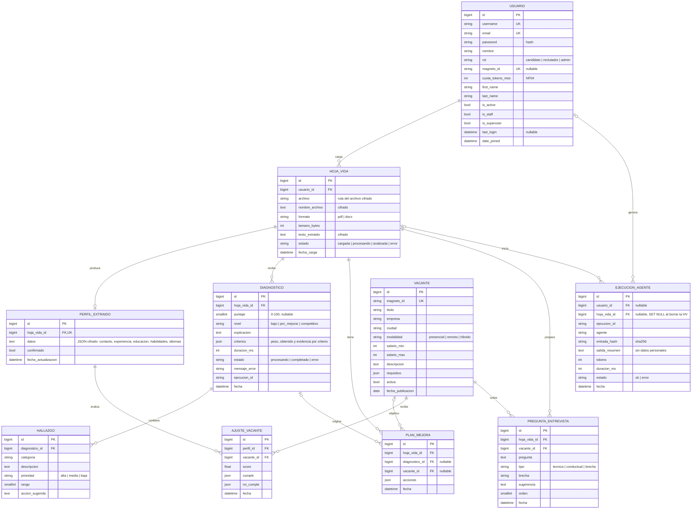

# Diagrama entidad-relación (modelos reales del núcleo)

> Pendiente: exportar imagen desde draw.io.

Generado 1 a 1 desde `backend/core/models.py` (migración única `core/migrations/0001_initial.py`).
`PK` llave primaria, `FK` llave foránea, `UK` única. Los campos marcados "cifrado" se guardan con Fernet (NF02).
`USUARIO` hereda de `AbstractUser` de Django (sus relaciones con grupos y permisos no se dibujan).

Restricción adicional: `AJUSTE_VACANTE (perfil_id, vacante_id)` es única.

## Diferencias con el ER del informe (Entrega 2)

| Informe | Implementado | Motivo |
|---|---|---|
| `HV_ADAPTADA`, `POSTULACION` | No se crean | Pertenecen al Sprint 3 (HU12-HU15) |
| `PLAN_MEJORA.diagnostico_id` obligatorio | `diagnostico_id` opcional + `hoja_vida_id` + `vacante_id` | HU17 genera el plan desde una vacante |
| No existe | `PREGUNTA_ENTREVISTA` | HU16 guarda las preguntas generadas |
| `DIAGNOSTICO` (puntaje, explicacion, duracion_ms, fecha) | + `nivel`, `criterios`, `estado`, `mensaje_error`, `ejecucion_id` | HU05 nivel, HU07 explicabilidad, NF01 progreso |
| `HALLAZGO` | + `accion_sugerida`, `rango` | HU06 acción sugerida y orden por prioridad |
| `HOJA_VIDA` | + `nombre_archivo`, `tamano_bytes`, `estado`; texto y nombre cifrados | HU02, NF02 |
| `PERFIL_EXTRAIDO.datos` JSON | Texto con JSON cifrado | NF02 |
| `EJECUCION_AGENTE` | + `hoja_vida_id`, `ejecucion_id` | NF01 progreso por ejecución, NF05 |
| `USUARIO` | Hereda de `AbstractUser` (login por correo) | Autenticación de Django |
| `VACANTE` | + `descripcion`, `activa`, `fecha_publicacion` | Lista y detalle de vacantes |
